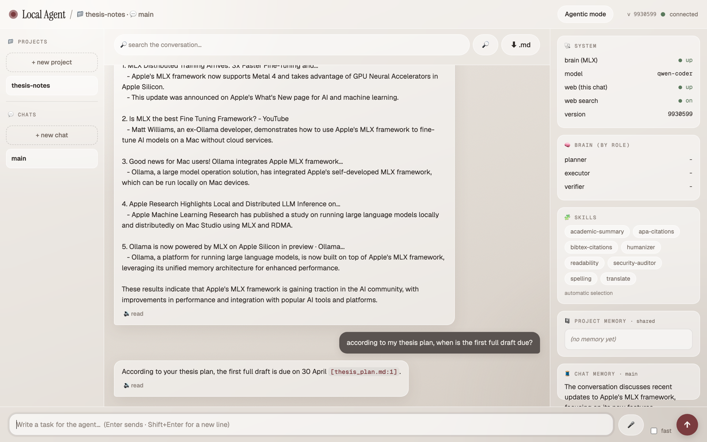
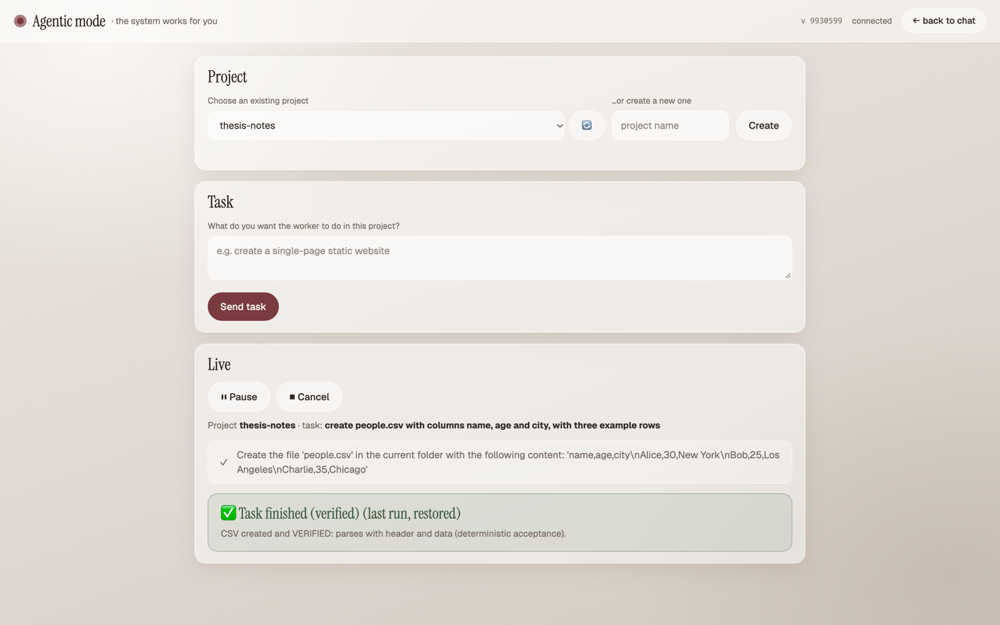

# Local AI Assistant on MLX: chat + agent

**A self-built, desktop-style AI assistant for the Mac (a chat and an agent in one app) running local models through Apple's MLX: a 14B Qwen2.5-Coder (4-bit) brain, on-demand vision, 100% local by default, and free.**

[](https://github.com/arratenogales-ai/mlx-local-agent/actions/workflows/ci.yml)
[](https://github.com/arratenogales-ai/mlx-local-agent/actions/workflows/codeql.yml)
[](https://github.com/astral-sh/ruff)
[](pyproject.toml)
[](LICENSE)
[](#what-it-is)



## What it is

My own AI assistant app, built from scratch. One web app works both as a **chat** and as an **agent**:

- **Chat:** projects with several chats each, documents with cited answers, voice, and images.
- **Agent:** carries out multi-step tasks with tools, verifies the result with code, and can stop between stages for your approval.

It runs a **14B model (`mlx-community/Qwen2.5-Coder-14B-Instruct-4bit`, ~7.7 GB)** directly on the Mac through MLX:

- **Model server:** one `vllm-mlx` process on loopback (`127.0.0.1:8000`), with OpenAI- and Anthropic-compatible APIs.
- **Vision:** loaded only when you attach an image.
- **Network:** everything is local and free. **Web search** (arXiv + DuckDuckGo) is optional and **off in the shipped template**.

Validated on a MacBook Pro M4 Pro with 24 GB of RAM.

## Quick start

Requirements: a Mac with Apple Silicon, Python 3.12, and ~10 GB free for the model.

```bash
git clone https://github.com/arratenogales-ai/mlx-local-agent.git
cd mlx-local-agent
python3.12 -m venv .venv && source .venv/bin/activate
pip install -r requirements.txt
pip install -r requirements-security.txt   # patched indirect deps (Pillow 13…)
cp config.env.example config.env          # every setting lives here

# 1) the model server (downloads the model on first run; loopback only)
vllm-mlx serve mlx-community/Qwen2.5-Coder-14B-Instruct-4bit --served-model-name qwen-coder \
  --host 127.0.0.1 --port 8000 --enable-auto-tool-choice --tool-call-parser qwen

# 2) in another terminal: the web UI → http://127.0.0.1:8080  (agentic mode: /agentic)
python src/web_server.py

# or the command line
python src/orchestrator.py -p "create calc.py with an add function and its pytest test"
python src/orchestrator.py --self-audit       # deterministic security self-audit
```

Optional extras:
- `pip install mlx-vlm` for vision.
- `brew install pandoc poppler` for `.docx` and `.pdf`.

Anything optional that is missing degrades honestly. After an optional `pip install`, run `pip install -r requirements-security.txt` again so no patch gets rolled back.

## Why it is different

The harness, not the model, is responsible for correctness. It is designed around the limits of a 14B.

- **Deterministic over the model.** Verifiers check the real files on disk: they parse the CSV, open the notebook and run the tests. Verdicts are tri-state (`OK` / `FAIL` / `inconclusive`) and read from a whitelist. The model narrates; code decides.
- **Never a false success.** Anything verified is ✅, anything done without strong verification is ⚠️, and anything that could not be done is ⏹️. The chat verifier is read-only: if it changes anything, the change is reverted and its verdict does not count.
- **Light context.** The model receives top-k cited fragments, a running summary and the last N messages, never whole files or whole histories.
- **Bounded and honest.** Iterations, output, downloads, uploads and time are capped. Loops are detected, and the agent stops and says where it got to.
- **Secure by default.**
  - Tools are confined to the project and the shell has a destructive-command guard.
  - The web tools defend against SSRF and DNS rebinding, and the local web app checks Host, Origin and request size.
  - A deterministic self-audit runs SAST and checks its own security invariants.



*A real agentic run: the worker created `people.csv`, and the verdict came from a deterministic check that parses the CSV on disk, not from the model.*

## Project structure

| Path | What it is |
| --- | --- |
| `src/agent.py` | The executor: tools, the tool-calling loop, the shell guard |
| `src/orchestrator.py` | Triage → plan → execute → verify; document/web/skill shortcuts; CLI |
| `src/worker.py` | Agentic mode: passes verified by code, per-type verifiers, staged runs with approval |
| `src/web_server.py` | FastAPI backend for both pages (WebSocket, projects, chats, uploads, vision, undo) |
| `src/knowledge.py`, `src/embeddings.py` | Local retrieval: TF-IDF with citations, plus an optional semantic layer |
| `src/projects.py`, `src/chats.py`, `src/time_machine.py` | Projects, chats, recoverable trash, snapshots and undo |
| `src/web_tools.py`, `src/vision.py`, `src/voice.py` | Web search, on-demand vision, local voice |
| `src/test_runner.py`, `src/self_audit.py` | The single test runner (pytest + JUnit) and the security self-audit |
| `src/skills.py`, `skills/` | Pluggable skills: chosen by TF-IDF above a threshold, one per turn |
| other `src/` modules | Notebooks, code tools, documents (pandoc), conversation export, model-server control, events |
| `web/` | `index.html` (chat) and `agentic.html` (agent). Self-contained HTML/CSS/JS, no CDN |
| `tests/` | The model-free test suite |

The writing skills analyse **Spanish** text. Their code is in English, but their word lists and rules are Spanish by design, because that is the language they measure.

## Hardened by a full audit

Four independent reviewers read every module. Each finding was reproduced with a script before it was fixed, and each fix ships with a regression test that fails on the previous code. The fixes cover:

- **False successes:**
  - a whitelist verdict parser;
  - skipped tests no longer count as passing;
  - a read-only verifier;
  - an unverified stage can never end a run as ✅.
- **Data loss:** a safe trash, and an undo that checks hashes and never overwrites your later edits.
- **Security:**
  - a request guard against DNS rebinding and cross-site requests;
  - bounded gzip decoding (a 194 KB bomb used to inflate to 449 MB);
  - pandoc kept inside the project;
  - symlink checks.
- **Robustness:**
  - a central cap on tool output;
  - the chat stays responsive while the agent waits for approval;
  - a backend↔UI contract test.

## Tests

```bash
python -m unittest discover -s tests          # no model, no network
```

CI runs the suite on Python 3.11, 3.12 and 3.13, together with `ruff check` and `ruff format --check`.

## Honest limits

- **The 14B can drift on vague tasks.** Concrete requests ("create `x.py` that does Y") are far more reliable.
- **Retrieval is lexical by default.** A question in one language will not find a document in another unless you turn on `EMBEDDINGS=1`.
- **The shell guard is best-effort, not a sandbox.** `run_bash` can reach whatever your user can. `--confirm-bash` asks before each command.
- **The vision RAM hand-off needs a launcher script,** which this repository does not ship. Without it, vision never stops the brain, and it tells you when there is not enough free RAM.
- **The optional cloud brain is free-only.** It is used only when configured; otherwise everything stays local.

## License

MIT © arratenogales-ai. See [LICENSE](LICENSE).
