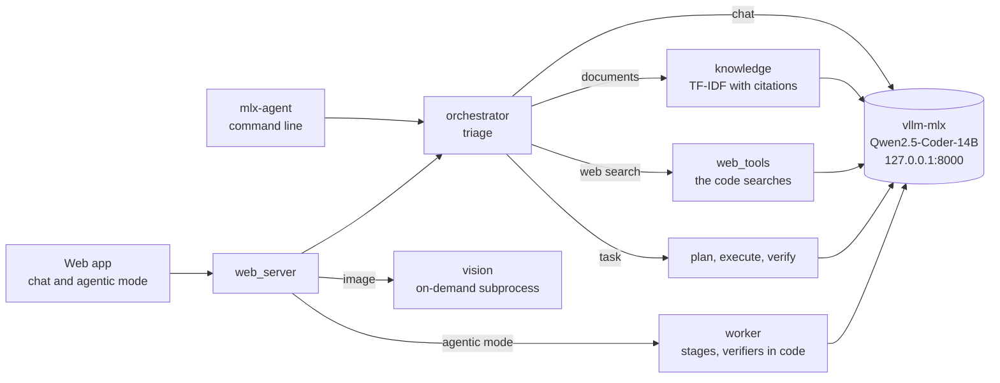

# Local AI Assistant on MLX: chat + agent

**A self-built, desktop-style AI assistant for the Mac (a chat and an agent in one app) running local models through Apple's MLX: a 14B Qwen2.5-Coder (4-bit) brain, on-demand vision, 100% local by default, and free.**

[](https://github.com/arratenogales-ai/mlx-local-agent/actions/workflows/ci.yml)
[](https://github.com/arratenogales-ai/mlx-local-agent/actions/workflows/codeql.yml)


## What it is

My own AI assistant app, built from scratch. One web app works both as a **chat** and as an **agent**:

- **Chat:** projects with several chats each, documents with cited answers (PDF, docx, xlsx, pptx), local voice, images, optional web search, and skills (spelling, readability, APA/BibTeX citations, academic summaries, translation, a humanizer, a security auditor).
- **Agent:** carries out multi-step tasks with tools (code with its tests, web pages, CSV, notebooks, Word, Excel and PowerPoint files), verifies each result with code, and can stop between stages for your approval.
- **Undo:** every change the agent makes can be rolled back.

It runs a **14B model (`mlx-community/Qwen2.5-Coder-14B-Instruct-4bit`, ~7.7 GB)** directly on the Mac through MLX:

- **Model server:** one `vllm-mlx` process on loopback (`127.0.0.1:8000`), with OpenAI- and Anthropic-compatible APIs.
- **Vision:** `gemma-4-12b-it-4bit`, loaded only when you attach an image. If both models do not fit in RAM, the brain pauses while the image is read and always comes back.
- **Network:** everything is local and free. **Web search** (arXiv + DuckDuckGo) is optional and **off in the shipped template**.

Validated on a MacBook Pro M4 Pro with 24 GB of RAM.

## How it works



A request is triaged by code first: greetings are answered without asking the model, questions about your documents go to retrieval, clear web searches are run by the code (the model only writes the answer and cites the URLs), and real work goes through plan, execute and verify. The model writes; code decides what counts as done.

## Why it is different

The harness, not the model, is responsible for correctness. It is designed around the limits of a 14B.

- **Deterministic over the model.** Verifiers check the real files on disk: they parse the CSV, open the notebook and run the tests. Verdicts are tri-state (`OK` / `FAIL` / `inconclusive`) and read from a whitelist. The model narrates; code decides.
- **Never a false success.** Anything verified is ✅, anything done without strong verification is ⚠️, and anything that could not be done is ⏹️. The chat verifier is read-only: if it changes anything, the change is reverted and its verdict does not count.
- **Light context.** The model receives top-k cited fragments, a running summary and the last N messages, never whole files or whole histories.
- **Bounded and honest.** Iterations, output, downloads, uploads and time are capped. Loops are detected, and the agent stops and says where it got to.
- **Secure by default.**
  - Tools are confined to the project and the shell has a destructive-command guard.
  - The web tools defend against SSRF and DNS rebinding, web content is treated as data and never as instructions, and the local web app checks Host, Origin and request size.
  - A deterministic self-audit runs SAST, checks its own security invariants and audits every installed package.


*A real agentic run: the worker created `people.csv`, and the verdict came from a deterministic check that parses the CSV on disk, not from the model.*

## Requirements

- A Mac with **Apple Silicon** (MLX does not run anywhere else). 24 GB of RAM is what it was validated on.
- [**uv**](https://docs.astral.sh/uv/). It installs Python 3.12 and every dependency at the exact version in `uv.lock`.
- About **10 GB** of free disk for the brain model, plus about 8 GB more if you use vision. Models download on first use.
- Optional: `brew install pandoc poppler` to read and write `.docx` and to read `.pdf`.

## Installation

```bash
git clone https://github.com/arratenogales-ai/mlx-local-agent.git
cd mlx-local-agent
uv sync --all-extras                  # everything, including vision and semantic search
cp config.env.example config.env      # every setting lives here
```

`uv sync` alone installs the core without vision (`--extra vision`) and semantic search (`--extra embeddings`). Anything optional that is missing degrades honestly and says so.

## Running it

```bash
uv run mlx-agent-brain     # 1) the model server, with the model and flags from config.env (loopback only)
uv run mlx-agent-web       # 2) in another terminal: http://127.0.0.1:8080  (agentic mode: /agentic)
```

Or from the command line:

```bash
uv run mlx-agent -p "create calc.py with an add function and its pytest test"
uv run mlx-agent --self-audit          # deterministic security self-audit
uv run mlx-agent --help                # every option
```

`mlx-agent-brain` refuses to listen beyond loopback and will not start a second server on a port that is already taken. The vision RAM hand-off uses the same command to bring the brain back.

## Configuration

Everything is in `config.env` (gitignored; the template is `config.env.example`). The settings you are most likely to touch:

| Setting | Default | What it does |
| --- | --- | --- |
| `MLX_MODEL`, `SERVED_MODEL_NAME` | Qwen2.5-Coder-14B 4-bit, `qwen-coder` | The brain model and the name it is served under |
| `SERVER_PORT`, `WEB_PORT` | `8000`, `8080` | Ports of the model server and the web app (both on loopback) |
| `AGENT_PROJECTS_DIR` | `~/agent_projects` | Where projects, documents, chats and snapshots are kept |
| `WEB_SEARCH` | `0` | `1` lets the assistant search arXiv and DuckDuckGo |
| `VISION_MODEL` | `gemma-4-12b-it-4bit` | Image reader; empty turns vision off |
| `EMBEDDINGS` | `0` | `1` adds semantic retrieval, which also finds documents in another language |
| `WORKER_STAGES` | `1` | Agentic runs stop between stages for your approval |
| `STRONG_BASE_URL`, `STRONG_MODEL` | empty | Optional cloud planner/verifier, free models only. Empty = 100% local |

## Project structure

| Path | What it is |
| --- | --- |
| `src/mlx_local_agent/agent.py` | The executor: tools, the tool-calling loop, the shell guard |
| `src/mlx_local_agent/orchestrator.py` | Triage, then plan, execute and verify; document, web and skill shortcuts; the `mlx-agent` command |
| `src/mlx_local_agent/worker.py` | Agentic mode: passes verified by code, per-type verifiers, staged runs with approval |
| `src/mlx_local_agent/web_server.py` | FastAPI backend for both pages (WebSocket, projects, chats, uploads, vision, undo) |
| `knowledge.py`, `embeddings.py` | Local retrieval: TF-IDF with citations, plus an optional semantic layer |
| `projects.py`, `chats.py`, `time_machine.py` | Projects, chats, recoverable trash, snapshots and undo |
| `web_tools.py`, `vision.py`, `voice.py` | Web search, on-demand vision, local voice |
| `brain.py` | The `mlx-agent-brain` launcher and the model server's health and hand-off |
| `test_runner.py`, `self_audit.py` | The single test runner (pytest + JUnit) and the security self-audit |
| `skills.py`, `skills/` | Pluggable skills: chosen by TF-IDF above a threshold, one per turn |
| `web/` | `index.html` (chat) and `agentic.html` (agent). Self-contained HTML, CSS and JS, fonts included, no CDN |
| `tests/` | The model-free test suite, including the publishing rules |
| `pyproject.toml`, `uv.lock` | Dependencies (direct ones pinned, every indirect one locked) and the lint rules |

The writing skills analyse **Spanish** text. Their code is in English, but their word lists and rules are Spanish by design, because that is the language they measure.

## Hardened by a full audit

Four independent reviewers read every module. Each finding was reproduced with a script before it was fixed, and each fix ships with a regression test that fails on the previous code. The fixes cover:

- **False successes:**
  - a whitelist verdict parser;
  - skipped tests no longer count as passing;
  - a read-only verifier;
  - an unverified stage can never end a run as ✅.
- **Data loss:** a safe trash, and an undo that checks hashes and never overwrites your later edits.
- **Security:**
  - a request guard against DNS rebinding and cross-site requests;
  - bounded gzip decoding (a 194 KB bomb used to inflate to 449 MB);
  - pandoc kept inside the project;
  - symlink checks.
- **Robustness:**
  - a central cap on tool output;
  - the chat stays responsive while the agent waits for approval;
  - a backend and UI contract test.

## Tests and checks

```bash
uv run python -m unittest discover -s tests     # no model, no network
uv run ruff check . && uv run ruff format --check .
```

- **CI** runs on macOS with Apple Silicon, installs exactly what `uv.lock` pins and runs lint, format and the suite on every push.
- **Publishing rules** are part of the suite: no personal e-mail addresses, home-folder paths, secrets or local config in the repository, no metadata in the images, and commits only under the account's anonymous GitHub address.
- **CodeQL** scans the Python and JavaScript code on every push and once a week.

## Honest limits

- **Apple Silicon only, one person, one Mac.** There are no user accounts: the web app listens on loopback and trusts whoever sits at the keyboard.
- **The 14B can drift on vague tasks.** Concrete requests ("create `x.py` that does Y") are far more reliable, and it struggles to debug long tasks. When it does not get there, the run ends as ⏹️ instead of pretending.
- **Retrieval is lexical by default.** A question in one language will not find a document in another unless you turn on `EMBEDDINGS=1`.
- **The shell guard is best-effort, not a sandbox.** `run_bash` can reach whatever your user can. `--confirm-bash` asks before each command.
- **The tests do not exercise the real model.** They check the harness; how well the 14B behaves was measured separately, with model benchmarks and hands-on tests.
- **The optional cloud brain is free-only.** It is used only when configured; otherwise everything stays local.

## License

MIT © arratenogales-ai. See [LICENSE](LICENSE).
